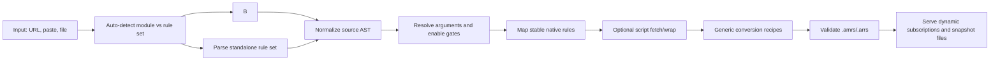

# Architecture

The converter is split into small runtime-neutral entry points instead of a monolithic Worker.

## Files

| File | Role |
| --- | --- |
| `src/core.mjs` | Parser, normalization, rule mapping, emitter, validator, script wrapper. |
| `bin/cli.mjs` | Local command-line entry point. |
| `src/worker.mjs` | Cloudflare Worker API, source fetching, KV persistence, rule serving. |
| `src/ui.mjs` | Worker browser UI rendering. |
| `test/core.test.mjs` | Node test suite for parser/emitter/mapping behavior. |

## Pipeline

## Conversion Modes

| Mode | Default | Behavior |
| --- | --- | --- |
| `compat` | yes | Downloads remote scripts by default, lifts high-confidence JavaScript patterns including static URL-guarded JSON mutations, wraps common Loon/Surge APIs, and merges same-phase scripts into gated dispatchers. Output is usually `partial` or `sample-required`. |
| `aggressive` | no | Starts from `compat`, then additionally lifts selected assumption-heavy JSON cleanup idioms such as array `splice(0)` clears. It does not native-lift protobuf, binary, dynamic code, helper-function mutation, or external HTTP-driven transformations. |

The Worker UI exposes a standard conversion path backed by `compat` with remote script fetching enabled, plus an opt-in "增强 JS 原生化" switch for `aggressive`.

See [Conversion Modes](conversion-modes.md) for the detailed `compat` / `aggressive` behavior boundary.

## Worker Link Model

URL-based conversions return dynamic subscription links by default:

- `/sub/mitm.amrs?url=<module-url>`
- `/sub/reject.arrs?url=<module-url>`
- `/sub/direct.arrs?url=<module-url>`
- `/sub/rule.arrs?url=<module-url>`
- `/sub/deeplink?url=<module-url>`

These links preserve the original module or rule-set URL in the subscription, so Anywhere can receive updated conversion output after upstream content changes and the Worker cache expires. Standalone rule sets can include `sourceKind=ruleset` and `ruleSetRouting=default|direct|reject` in the query when the source has no embedded policy action. URL-based conversions do not generate hashes. The API only emits hash-backed `/r/:hash/*` snapshot links when the input cannot be represented as a public dynamic subscription, such as paste-only input or conversions that depend on manual `scriptTextByURL` recovery.

## Known Boundaries

- Anywhere has one buffered script per matching message; same-gate scripts are composed, and same-phase script rules are merged into gated dispatchers.
- Request scripts cannot directly mutate URL, method, or headers. Those must be lifted to native rewrite/header rules.
- Protobuf/binary scripts can be preserved, but schema-level equivalence requires samples and endpoint-specific recipes.
- `DOMAIN` exact semantics cannot be represented in Anywhere routing; it is emitted as suffix with diagnostics.

## Script Cost Metrics

Conversion reports include `scriptRuleCount`, `totalScriptBytes`, and `maxPerHitScriptBytes`. The last value is the most relevant hot-path number because Anywhere compiles the selected script source for every invocation and executes at most one buffered script per message. Native-only outputs report zero script bytes.

As of 2026-10-10, complete AST validation gates JavaScript lifts. Static runners share source across parameter variants; body-only scripts use a smaller adapter and decode text lazily. Dispatcher parts are awaited sequentially. Acorn is bundled into the Worker, not downloaded by the browser.

As of 2026-10-16, `qx.mjs` parses QX rewrite actions and extracts self-identifying rewrite metadata from actual JS comments. Both enter the existing module pipeline and share its resource budgets. Section names are case-insensitive. Do not globally deduplicate ordered mutations: repeated native deletes/adds may be required. The response adapter rejects unavailable original-request fields instead of substituting response data. AMOD also preserves upstream `description`/`desc` metadata.

`outputFormat=auto` (also omitted/empty) bundles plugins as AMOD and leaves plain rule sets standalone. Explicit `amod` / `standalone` override this choice. `convertModule` / `convertRuleSet` remain low-level standalone producers. Budget estimation projects native Codable fields, counting UTF-8 and slash escaping, plus a 4096-byte reserve for subscription metadata and ordinary parameter overrides. It is not an upper bound for arbitrarily long user edits; the app's final validation remains authoritative. Excessive budgets preserve all standalone files. Dynamic split subscriptions use a zero-based `part` query parameter; concrete AMRS/ARRS paths always remain standalone, while module paths always request AMOD. Existing module subscriptions that exceed capacity return HTTP 422 with standalone alternatives, never partial/empty successful modules. Published Rule Studio memory copies expire; HTTP caching cannot extend their remaining freshness window. See [module output](module-output.md).
